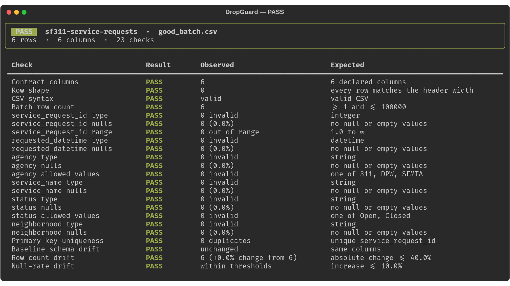
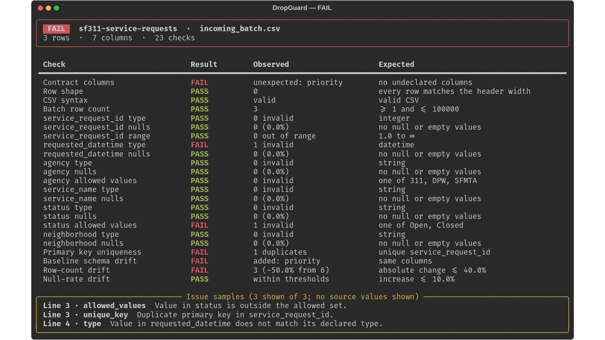

# DropGuard

**Catch bad data drops before they reach your pipeline.**

DropGuard is a small Python CLI that checks incoming CSV batches against a TOML data contract and a reviewed-good baseline. It is a reusable pre-ingestion gate—not another one-off ETL pipeline.

[](https://github.com/sujan-reddy-p/dropguard/actions/workflows/ci.yml)


## See it catch a bad batch

The bundled SF311 example has a known-good batch and an intentionally broken incoming batch. The screenshots are actual DropGuard CLI output; sample rows are illustrative, not a live city feed.

**Clean batch — gate passes**



**Incoming batch — gate blocks schema, quality, and volume regressions**



## What it checks

Define what “good” means once in a TOML contract, then use the same gate on every incoming batch.

| Check | Example failure caught |
| --- | --- |
| **Schema** | A required column disappears or an unapproved column appears |
| **Types and values** | A timestamp no longer parses; a status falls outside its allowed set |
| **Nulls and numeric bounds** | A required field is empty or a measurement exceeds its declared range |
| **Keys and row shape** | A primary key repeats or a row has too many/few fields |
| **Batch drift** | Row count changes too much, or a column’s null rate rises past its threshold |

DropGuard reads records incrementally, reports aggregate counts and a small sample of issue locations, and never prints cell values in diagnostics. A profile contains only the source filename, column names, row count, null rates, and creation time—not the dataset’s rows.

## Example workflow

Install Python 3.11+ and run from a checkout:

```bash
git clone https://github.com/sujan-reddy-p/dropguard.git
cd dropguard
python -m venv .venv
. .venv/bin/activate
python -m pip install .
```

Create a baseline from data you have reviewed and trust:

```bash
dropguard snapshot \
  --input examples/sf311/good_batch.csv \
  --output /tmp/sf311-baseline.json
```

Gate a new batch and optionally save reports for a pipeline or CI artifact:

```bash
dropguard validate \
  --contract examples/sf311/contract.toml \
  --input examples/sf311/incoming_batch.csv \
  --baseline /tmp/sf311-baseline.json \
  --json-report reports/sf311.json \
  --markdown-report reports/sf311.md
```

The bundled incoming batch is deliberately invalid, so this command exits with status **1**. Use `good_batch.csv` in place of `incoming_batch.csv` to see a passing run. Exit status `0` means the batch passed; `1` means contract or drift checks failed; `2` means the input, contract, or command could not be processed.

## Contract example

`examples/sf311/contract.toml` demonstrates the contract format:

```toml
[dataset]
name = "sf311-service-requests"
primary_key = "service_request_id"
min_rows = 1
max_rows = 100000
allow_extra_columns = false

[columns.service_request_id]
type = "integer"
nullable = false
min = 1

[columns.status]
type = "string"
nullable = false
allowed = ["Open", "Closed"]

[drift]
max_row_count_change = 0.40       # maximum relative change: 40%
max_null_rate_increase = 0.10     # maximum increase: 10 percentage points
```

Column types: `string`, `integer`, `number`, `boolean`, `date`, and `datetime`. Rules can also set `allowed` values, numeric `min`/`max`, `nullable`, and `max_null_rate`. Extra columns can be rejected or permitted with a warning.

## Why it is useful in a data workflow

- Run it before a CSV-to-database load so bad headers, keys, dates, and null spikes fail early.
- Call it from CI or an orchestrated job; its exit code is a pipeline gate and its JSON report is machine-readable.
- Keep a reviewed profile for a known-good delivery and detect schema, row-count, and null-rate changes in the next drop.
- Use it with any CSV export—not just 311 data. The SF311 fixture demonstrates the workflow without requiring an API key, network connection, database, or large dataset.

## Scope and safety

- CSV only. It does not ingest data into a database, query rows, transform files, or replace an orchestrator.
- Type and content checks are deterministic contract rules; there is no LLM or cloud service.
- It retains aggregate metrics and the unique-key set needed for duplicate detection; reports include line numbers and column names, not offending values.
- Profiles and reports contain filenames, schema names, and statistics. Treat those as potentially sensitive metadata.
- Schema drift is compared by column names; row drift is an absolute relative row-count change; null drift detects increases against the baseline.

## Development

```bash
python -m pip install -e '.[dev]'
ruff check src tests
pytest
python -m build
```

GitHub Actions tests Python 3.11–3.13, builds the package, and runs both the passing and intentionally failing SF311 examples.

## License

MIT. See [LICENSE](LICENSE).
